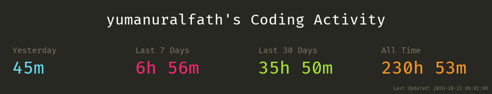
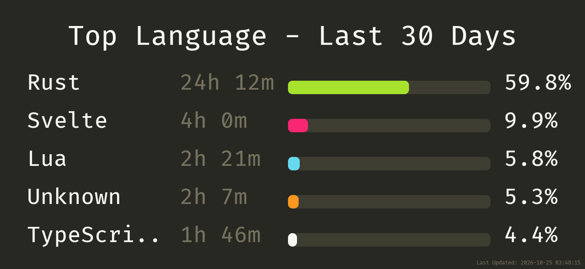
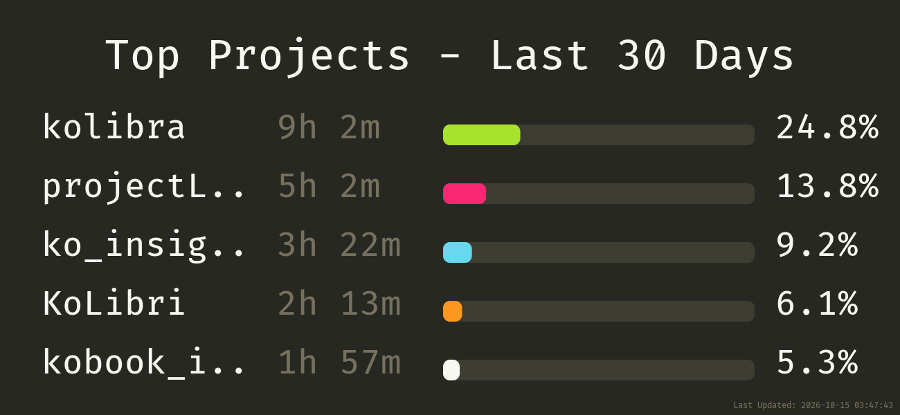
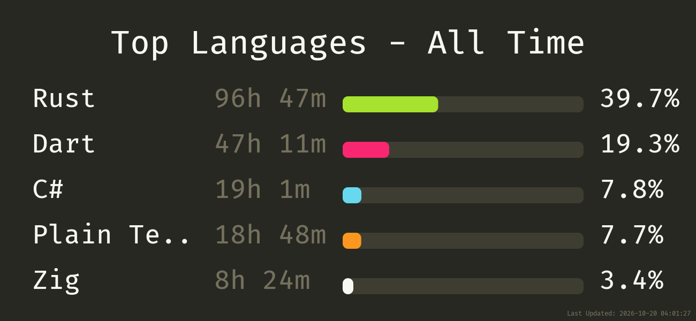
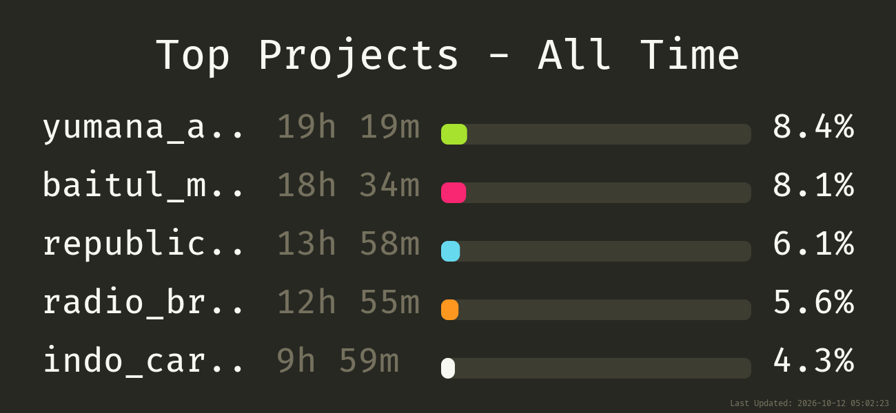
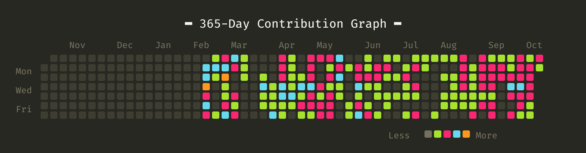
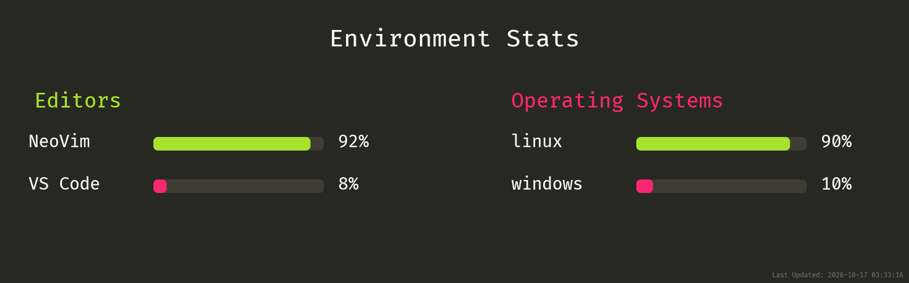

<div align='center'>
<summary><h1 style="color: red;">Welcome to My Profile✨</h1></summary>
</div>
<div align="center">
<!--horizontal divider(gradiant)-->

</div>
  
</div>
<!--h1 without bottom border-->

<!--takatime-start-->

<h2 align="center">TakaTime Weekly Report</h2>

<p align="center">
  <br/>
  
  <br/>
  
  <br/>
  
  
</p>

<p align="center"><em>Generated automatically by <a href="https://github.com/Rtarun3606k/TakaTime">TakaTime</a></em></p>

<!--takatime-end-->
<p align="center">
  
</p>

**Code Time Since May 4, 2024**

- [](https://wakatime.com/@dc384f06-ca40-47b3-af9c-3e0560a1bcfa)
- [](https://leetcode.com/yumanuralfath)
  <!--START_SECTION:waka-->


**I'm an Early 🐤** 

```text
🌞 Morning                1000 commits        █████████████░░░░░░░░░░░░   53.13 % 
🌆 Daytime                451 commits         ██████░░░░░░░░░░░░░░░░░░░   23.96 % 
🌃 Evening                384 commits         █████░░░░░░░░░░░░░░░░░░░░   20.40 % 
🌙 Night                  47 commits          █░░░░░░░░░░░░░░░░░░░░░░░░   02.50 % 
```
📅 **I'm Most Productive on Saturday** 

```text
Monday                   281 commits         ████░░░░░░░░░░░░░░░░░░░░░   14.93 % 
Tuesday                  288 commits         ████░░░░░░░░░░░░░░░░░░░░░   15.30 % 
Wednesday                315 commits         ████░░░░░░░░░░░░░░░░░░░░░   16.74 % 
Thursday                 184 commits         ██░░░░░░░░░░░░░░░░░░░░░░░   09.78 % 
Friday                   248 commits         ███░░░░░░░░░░░░░░░░░░░░░░   13.18 % 
Saturday                 325 commits         ████░░░░░░░░░░░░░░░░░░░░░   17.27 % 
Sunday                   241 commits         ███░░░░░░░░░░░░░░░░░░░░░░   12.81 % 
```


📊 **This Week I Spent My Time On** 

```text
💬 Programming Languages: 
Rust                     6 hrs 49 mins       ██████████████░░░░░░░░░░░   57.93 % 
Lua                      2 hrs 7 mins        █████░░░░░░░░░░░░░░░░░░░░   18.07 % 
TOML                     1 hr 40 mins        ████░░░░░░░░░░░░░░░░░░░░░   14.26 % 
Markdown                 12 mins             ░░░░░░░░░░░░░░░░░░░░░░░░░   01.77 % 
Bash                     12 mins             ░░░░░░░░░░░░░░░░░░░░░░░░░   01.75 % 

🐱‍💻 Projects: 
kolibra                  5 hrs 35 mins       ████████████░░░░░░░░░░░░░   47.46 % 
kindle_plugin            2 hrs 56 mins       ██████░░░░░░░░░░░░░░░░░░░   25.02 % 
rea                      1 hr 35 mins        ███░░░░░░░░░░░░░░░░░░░░░░   13.45 % 
rustlings                44 mins             ██░░░░░░░░░░░░░░░░░░░░░░░   06.30 % 
jurnal_yuma              32 mins             █░░░░░░░░░░░░░░░░░░░░░░░░   04.65 % 
```

🤖 **AI Coding This Week** 

```text
⏱ AI Coding Time: 4 hrs 34 mins (38.82%)

✍️ 5,956 lines written by AI, 1,675 lines written by hand (78.05% AI-written)

🔤 3,446,158 Input Tokens, 335,520 Output Tokens

💵 $10.74 Estimated AI Cost This Week

🧠 14 AI Sessions, 71 AI Prompts

Gemini                   4,448 lines         ███████████████████░░░░░░   74.59 % 
Github-Copilot           1,515 lines         ██████░░░░░░░░░░░░░░░░░░░   25.41 % 

🔎 AI Coding Insights:
🤖 AI-Driven — 78.05% of written lines came from AI
📄 Detailed Prompter — average 974 characters per prompt
🔁 Iterative Prompter — average 5 prompts per session
🚀 High AI Trust — 27.83% of changed lines were hand-edited
```

**I Mostly Code in Rust** 

```text
Rust                     25 repos            ██████░░░░░░░░░░░░░░░░░░░   22.32 % 
C#                       4 repos             █░░░░░░░░░░░░░░░░░░░░░░░░   03.57 % 
CSS                      3 repos             █░░░░░░░░░░░░░░░░░░░░░░░░   02.68 % 
Svelte                   3 repos             █░░░░░░░░░░░░░░░░░░░░░░░░   02.68 % 
GDScript                 1 repo              ░░░░░░░░░░░░░░░░░░░░░░░░░   00.89 % 
```


 Last Updated on 13/10/2026 21:48:21 UTC
<!--END_SECTION:waka-->

<!--h1 without bottom border-->
<!-- <div id="user-content-toc"> -->
<!--   <ul align="center"> -->
<!--     <summary><h2 style="display: inline-block">Technologies That I Know👨🏻‍💻</h2></summary> -->
<!--   </ul> -->
<!-- </div> -->
<!--tech stack icons-->
<!-- <p align="center"> -->
<!--   <a href="https://skillicons.dev"> -->
<!--      -->
<!--   </a> -->
<!-- </p> -->

<!-- Connect with me -->
<!--h2 without bottom border-->
<div id="user-content-toc">
  <ul align="center">
    <summary><h2 style="display: inline-block">Connect With Me🤝</h2></summary>
  </ul>
</div>

<!--icons and links-->
<p align="center">
<a href="https://www.linkedin.com/in/yumana/" target="blank"></a>
<a href="https://www.instagram.com/yumana20" target="blank"></a>
<a href="https://discordapp.com/users/393721612358254592" target="blank"></a>
  
</p>

<!--horizontal divider(gradiant)-->


---
