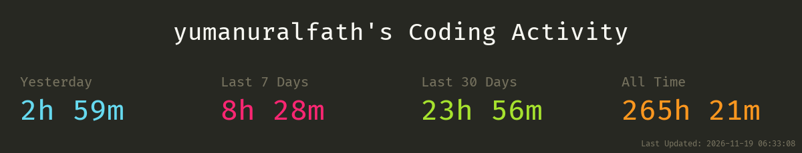
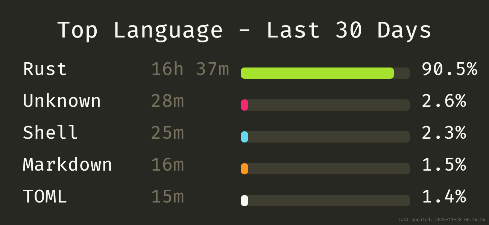
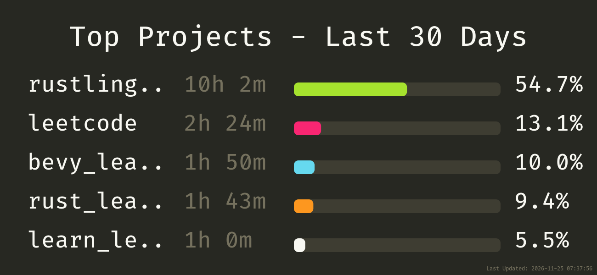
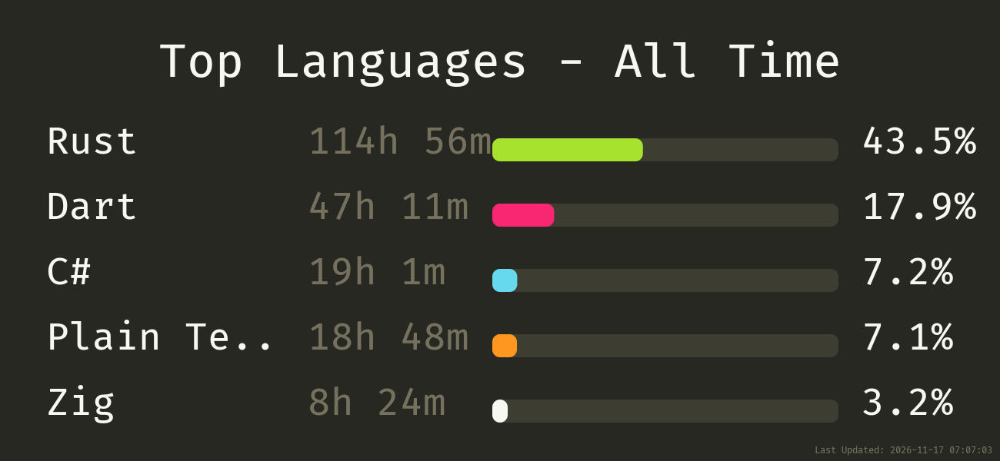
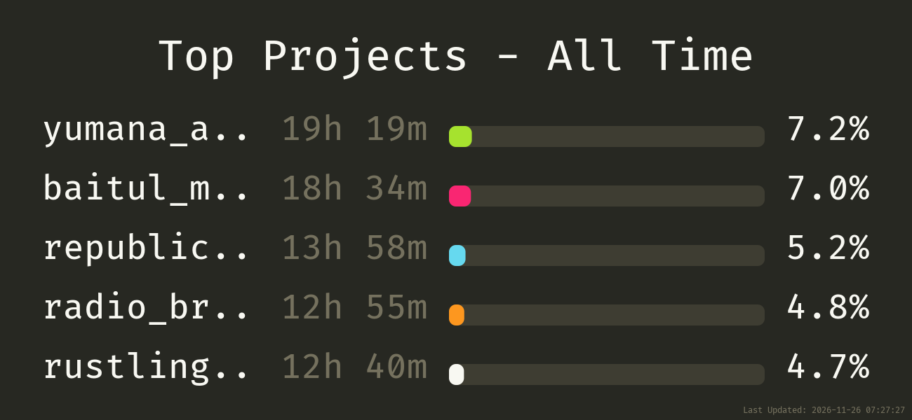
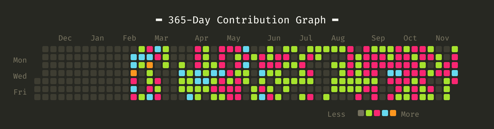
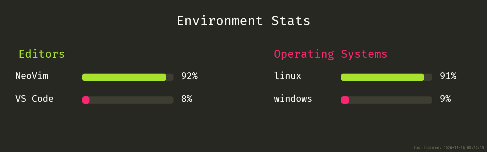

<div align='center'>
<summary><h1 style="color: red;">Welcome to My Profile✨</h1></summary>
</div>
<div align="center">
<!--horizontal divider(gradiant)-->

</div>
  
</div>
<!--h1 without bottom border-->

<!--takatime-start-->

<h2 align="center">TakaTime Weekly Report</h2>

<p align="center">
  <br/>
  
  <br/>
  
  <br/>
  
  
</p>

<p align="center"><em>Generated automatically by <a href="https://github.com/Rtarun3606k/TakaTime">TakaTime</a></em></p>

<!--takatime-end-->
<p align="center">
  
</p>

**Code Time Since May 4, 2024**

- [](https://wakatime.com/@dc384f06-ca40-47b3-af9c-3e0560a1bcfa)
- [](https://leetcode.com/yumanuralfath)
  <!--START_SECTION:waka-->


**I'm an Early 🐤** 

```text
🌞 Morning                1084 commits        ██████████████░░░░░░░░░░░   54.28 % 
🌆 Daytime                478 commits         ██████░░░░░░░░░░░░░░░░░░░   23.94 % 
🌃 Evening                388 commits         █████░░░░░░░░░░░░░░░░░░░░   19.43 % 
🌙 Night                  47 commits          █░░░░░░░░░░░░░░░░░░░░░░░░   02.35 % 
```
📅 **I'm Most Productive on Wednesday** 

```text
Monday                   296 commits         ████░░░░░░░░░░░░░░░░░░░░░   14.82 % 
Tuesday                  311 commits         ████░░░░░░░░░░░░░░░░░░░░░   15.57 % 
Wednesday                354 commits         ████░░░░░░░░░░░░░░░░░░░░░   17.73 % 
Thursday                 204 commits         ███░░░░░░░░░░░░░░░░░░░░░░   10.22 % 
Friday                   258 commits         ███░░░░░░░░░░░░░░░░░░░░░░   12.92 % 
Saturday                 325 commits         ████░░░░░░░░░░░░░░░░░░░░░   16.27 % 
Sunday                   249 commits         ███░░░░░░░░░░░░░░░░░░░░░░   12.47 % 
```


📊 **This Week I Spent My Time On** 

```text
💬 Programming Languages: 
Rust                     12 hrs 10 mins      ███████████████████████░░   93.01 % 
Other                    13 mins             ░░░░░░░░░░░░░░░░░░░░░░░░░   01.66 % 
Lua                      11 mins             ░░░░░░░░░░░░░░░░░░░░░░░░░   01.52 % 
HTML                     9 mins              ░░░░░░░░░░░░░░░░░░░░░░░░░   01.26 % 
JavaScript               9 mins              ░░░░░░░░░░░░░░░░░░░░░░░░░   01.22 % 

🐱‍💻 Projects: 
rustlings                6 hrs 7 mins        ████████████░░░░░░░░░░░░░   46.86 % 
leetcode                 3 hrs 25 mins       ███████░░░░░░░░░░░░░░░░░░   26.20 % 
learn_game_with_macroquad1 hr 4 mins         ██░░░░░░░░░░░░░░░░░░░░░░░   08.16 % 
learn_leetcode           1 hr 1 min          ██░░░░░░░░░░░░░░░░░░░░░░░   07.77 % 
Unknown Project          53 mins             ██░░░░░░░░░░░░░░░░░░░░░░░   06.76 % 
```

🤖 **AI Coding This Week** 

```text
⏱ AI Coding Time: 53 mins (6.8%)

✍️ 592 lines written by AI, 1,870 lines written by hand (24.05% AI-written)

🔤 422,389 Input Tokens, 37,635 Output Tokens

💵 $1.42 Estimated AI Cost This Week

🧠 7 AI Sessions, 20 AI Prompts

Vscode                   601 lines           █████████████████████████   100.00 % 
Gemini                   0 lines             ░░░░░░░░░░░░░░░░░░░░░░░░░   00.00 % 

🔎 AI Coding Insights:
🧑‍💻 Mostly Hands-On — 24.05% of written lines came from AI
📝 Concise Prompter — average 474 characters per prompt
🔁 Iterative Prompter — average 3 prompts per session
🔍 Hands-On Reviewer — 80.13% of changed lines were hand-edited
```

**I Mostly Code in Rust** 

```text
Rust                     26 repos            ██████░░░░░░░░░░░░░░░░░░░   22.81 % 
JavaScript               22 repos            █████░░░░░░░░░░░░░░░░░░░░   19.30 % 
Svelte                   4 repos             █░░░░░░░░░░░░░░░░░░░░░░░░   03.51 % 
CSS                      3 repos             █░░░░░░░░░░░░░░░░░░░░░░░░   02.63 % 
GDScript                 1 repo              ░░░░░░░░░░░░░░░░░░░░░░░░░   00.88 % 
```


 Last Updated on 21/11/2026 22:05:26 UTC
<!--END_SECTION:waka-->

<!--h1 without bottom border-->
<!-- <div id="user-content-toc"> -->
<!--   <ul align="center"> -->
<!--     <summary><h2 style="display: inline-block">Technologies That I Know👨🏻‍💻</h2></summary> -->
<!--   </ul> -->
<!-- </div> -->
<!--tech stack icons-->
<!-- <p align="center"> -->
<!--   <a href="https://skillicons.dev"> -->
<!--      -->
<!--   </a> -->
<!-- </p> -->

<!-- Connect with me -->
<!--h2 without bottom border-->
<div id="user-content-toc">
  <ul align="center">
    <summary><h2 style="display: inline-block">Connect With Me🤝</h2></summary>
  </ul>
</div>

<!--icons and links-->
<p align="center">
<a href="https://www.linkedin.com/in/yumana/" target="blank"></a>
<a href="https://www.instagram.com/yumana20" target="blank"></a>
<a href="https://discordapp.com/users/393721612358254592" target="blank"></a>
  
</p>

<!--horizontal divider(gradiant)-->


---
